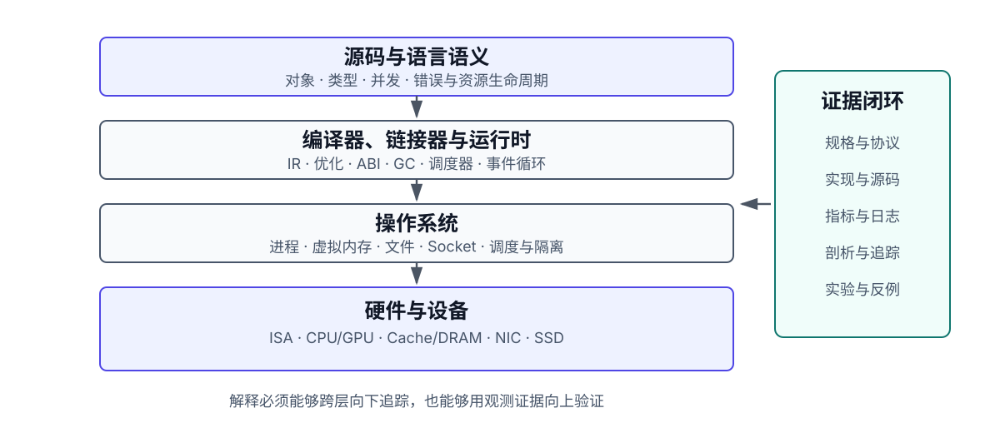

# Sys

从程序行为出发，沿编译、运行时、操作系统、网络与硬件追到真实机制。

<figure class="sys-figure" id="system-stack">
  
  <figcaption>一段程序的行为由多层契约共同决定；规格、实现和观测证据必须沿同一条路径对齐。示意图依据 <a href="https://csapp.cs.cmu.edu/">CS:APP 的全系统视角</a>与 <a href="https://docs.kernel.org/">Linux 内核文档</a>重新绘制。</figcaption>
</figure>

## 地图

| 入口 | 核心问题 | 继续阅读 |
| --- | --- | --- |
| 硬件与体系结构 | 一条指令怎样变成数据依赖、访存和执行资源竞争？ | [ISA 与微架构](architecture/isa-microarchitecture.md)、[缓存与一致性](architecture/cache-coherence.md)、[CPU](architecture/cpu.md)、[GPU](architecture/gpu-simt.md) |
| 操作系统与并发 | 资源怎样被复用、隔离、调度并在失败后保持可解释？ | [进程与线程](os/process-thread.md)、[虚拟内存](os/virtual-memory.md)、[协程](concurrency/coroutines.md)、[无锁与 RCU](concurrency/lock-free-rcu.md) |
| 网络与存储 | 数据怎样跨主机和持久介质移动，顺序与可靠性从何而来？ | [TCP、UDP 与 QUIC](network/transport-tcp-udp-quic.md)、[拥塞控制](network/congestion-control.md)、[SSD 与 NVMe](storage/ssd-nvme.md)、[崩溃一致性](storage/caching-logging-consistency.md) |
| 并行与分布式 | 工作怎样拆分，通信、同步、复制与失败怎样限制扩展？ | [性能模型](parallel/performance-models.md)、[CUDA](parallel/cuda.md)、[复制与共识](distributed/replication-consensus.md)、[事务与隔离](distributed/transactions-isolation.md) |
| 语言与工具链 | 源码语义如何穿过编译器、ABI、运行时和内核？ | [语言比较框架](languages/comparison.md)、[编译流水线](tooling/compiler-pipeline.md)、[链接与加载](tooling/linking-loading.md) |
| 性能与可观测性 | 如何证明瓶颈位于哪一层，并区分相关性与因果？ | [基准设计](performance/benchmarking.md)、[性能剖析](performance/profiling.md)、[指标、日志与追踪](performance/observability.md) |

## 一条贯穿全栈的路径

以一次网络请求为例，源码中的函数调用会依次穿过语言运行时、内存分配器、系统调用边界、Socket 缓冲区、传输协议、网卡队列、网络链路和远端机器；返回路径还可能触发调度、缓存未命中、锁竞争、GC、重传或排队。任何单层解释都可能正确，却不足以回答“为什么这次慢”。

本站统一使用六个问题拆解机制：

1. 契约是什么，允许观察到哪些行为？
2. 状态存在哪里，由谁拥有和更新？
3. 控制流怎样推进，何时阻塞、唤醒、取消或重试？
4. 数据经过哪些表示、缓存、队列与复制边界？
5. 主要成本和失败模式是什么？
6. 哪个实验或观测能够证伪当前解释？

第一次阅读可从[学习路线](guide/roadmap.md)开始；定位具体问题时，先看[阅读系统的方法](guide/method.md)。
